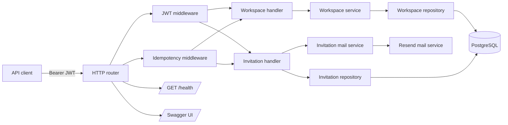
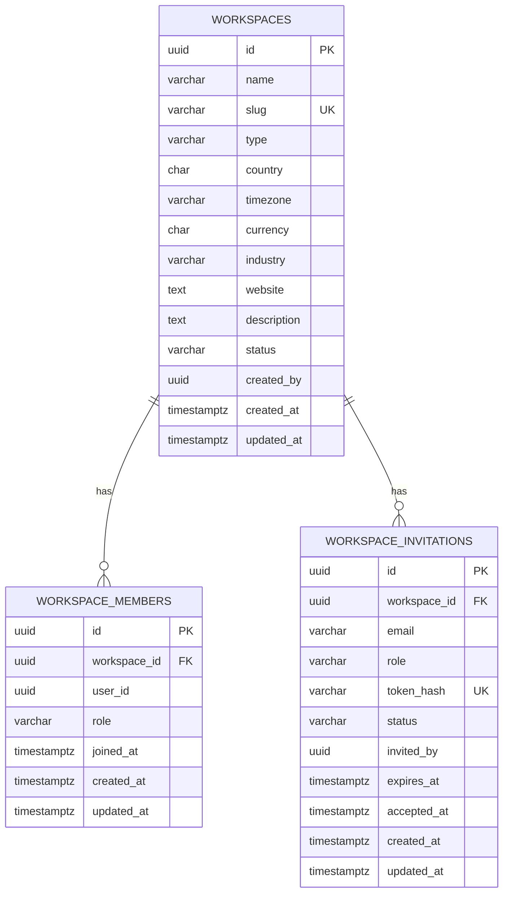

# AdOrbit Workspace

<p align="center">
  
  
  
  
  
</p>

AdOrbit Workspace is a Go HTTP backend for managing workspaces and their memberships. It provides authenticated workspace CRUD operations, PostgreSQL persistence, idempotent write requests, JWT validation, generated Swagger/OpenAPI documentation, and workspace invitation email delivery.

## Table of Contents

- [Overview](#overview)
- [Capabilities](#capabilities)
- [Architecture](#architecture)
- [Technology Stack](#technology-stack)
- [Project Structure](#project-structure)
- [Prerequisites](#prerequisites)
- [Setup](#setup)
- [Environment Variables](#environment-variables)
- [Running the Application](#running-the-application)
- [API Reference](#api-reference)
- [Database](#database)
- [Testing](#testing)
- [CI/CD](#cicd)
- [Security](#security)
- [Current Limitations](#current-limitations)
- [License](#license)

## Overview

The repository contains a single Go service. It registers versioned HTTP routes for workspace lifecycle operations and workspace invitations, verifies bearer JWTs, applies idempotency middleware to mutations, and stores records in PostgreSQL.

The application:

1. Loads configuration and environment variables.
2. Connects to PostgreSQL and runs application plus idempotency migrations.
3. Builds JWT, idempotency, workspace, membership, and mail dependencies.
4. Starts an HTTP server for the API and Swagger UI.
5. Handles graceful shutdown on `SIGINT` or `SIGTERM`.

## Capabilities

### Workspace management

- Create an advertiser or publisher workspace.
- Automatically generate a URL-style slug from the workspace name.
- Fetch active workspaces created by the authenticated user.
- Fetch a workspace by ID.
- Partially update supported workspace fields.
- Soft-delete a workspace by changing its status to `deleted`.
- Add the workspace creator to `workspace_members` with the `owner` role as part of workspace creation.

### Authentication and request safety

- Validate bearer JWTs with `JWT_PUBLIC_KEY`.
- Require authentication for workspace and invitation routes.
- Require an `Idempotency-Key` for create, update, delete, and invitation mutations.
- Scope idempotency records by operation and authenticated user.
- Apply separate encryption and scope-hash key material.

### Invitations

- Validate and persist a workspace invitation.
- Generate a cryptographically random 32-byte invitation token.
- Store only the SHA-256 hash of the token.
- Set an invitation lifetime of seven days.
- Send HTML and text invitation emails through the shared `adorbit-go` mail service.
- Normalize invitation email addresses and prevent duplicate workspace/email invitations.

## Architecture

The service uses a small layered architecture:



### Runtime flow

- `cmd/server/main.go` loads `.env`, validates configuration, configures Swagger, creates the application, and starts the server.
- `internal/app/app.go` opens PostgreSQL, runs migrations, builds the router, and owns database lifecycle.
- `internal/app/dependencies.go` wires the shared JWT and idempotency middleware into workspace and member services.
- `internal/api/api.go` exposes health and Swagger routes and mounts versioned handlers under `/api/v1`.
- `internal/workspace` implements workspace handlers, validation DTOs, business logic, routes, and SQL access.
- `internal/workspaceMember` implements invitation validation, token generation, persistence, and HTML/text email rendering.
- `internal/database` opens the `pgx` PostgreSQL connection and executes SQL and idempotency migrations.

## Technology Stack

| Category | Technology | Repository evidence | Use |
| --- | --- | --- | --- |
| Language | Go 1.27.1 | `go.mod`, Dockerfiles | Application implementation and tests |
| HTTP | Go `net/http` | `internal/api`, `internal/app/server.go` | Routing and server lifecycle |
| PostgreSQL | PostgreSQL 17 | `docker-compose.yml`, migrations | Workspace and membership persistence |
| PostgreSQL driver | `pgx/v5` | `go.mod`, `internal/database/database.go` | Database connection and SQL operations |
| Migration tool | `golang-migrate/migrate/v4` | `internal/database/migrate.go` | Application and idempotency migrations |
| Authentication | JWT middleware | `internal/app/dependencies.go` | Bearer JWT validation |
| Idempotency | `adorbit-go/idempotency` | Workspace and invitation routes | Replay protection for mutations |
| Mail | `adorbit-go/mailservice` + Resend | `internal/workspaceMember/invitation_mail.go` | Workspace invitation delivery |
| API documentation | Swaggo / OpenAPI 2 | `docs/swagger.*`, handler annotations | Generated Swagger JSON, YAML, and UI |
| Environment loading | `godotenv` | `cmd/server/main.go` | Optional `.env` loading |
| Development reload | Air | `.air.toml`, `Dockerfile.dev` | Live Go rebuild and Delve debugging |
| Containerization | Docker and Docker Compose | Dockerfiles, `docker-compose.yml` | Local app and PostgreSQL services |
| CI | GitHub Actions | `.github/workflows/go-tests.yml` | Test, race, and coverage execution |

## Project Structure

```text
.
├── .github/workflows/go-tests.yml
├── cmd/server/
│   ├── main.go
│   └── main_test.go
├── docs/
│   ├── docs.go
│   ├── swagger.json
│   └── swagger.yaml
├── internal/
│   ├── api/
│   ├── app/
│   ├── config/
│   ├── database/
│   │   └── migrations/
│   ├── workspace/
│   └── workspaceMember/
├── Dockerfile
├── Dockerfile.dev
├── docker-compose.yml
├── go.mod
├── go.sum
└── README.md
```

### Module responsibilities

| Path | Responsibility |
| --- | --- |
| `cmd/server` | Startup entry point and Swagger host configuration |
| `internal/api` | Top-level router, health endpoint, Swagger UI, and `/api/v1` mounting |
| `internal/app` | Dependency wiring, server lifecycle, and graceful shutdown |
| `internal/config` | Environment loading and key decoding |
| `internal/database` | PostgreSQL connection and migration execution |
| `internal/workspace` | Workspace CRUD handlers, service, repository, and routes |
| `internal/workspaceMember` | Workspace owner/member model and invitation implementation |
| `docs` | Generated Swagger/OpenAPI artifacts |

## Prerequisites

- Go 1.27.1 or a compatible Go toolchain.
- PostgreSQL 17 for the repository's Docker Compose stack or a compatible PostgreSQL instance.
- Docker and Docker Compose for containerized local development.
- A JWT public key accepted by the JWT middleware.
- A 64-character hexadecimal idempotency scope key.
- A 64-character hexadecimal idempotency response-encryption key.
- A Resend API key and verified sender email for successful invitation delivery.

## Setup

1. Clone the repository:

```bash
git clone https://github.com/thakur-vijay/AdOrbitWorkspace.git
cd AdOrbitWorkspace
```

2. Create or update a local `.env` file with the required application variables.

3. Start the PostgreSQL and application services:

```bash
docker compose up --build
```

Docker Compose reads `.env`, requires the PostgreSQL variables, and waits for PostgreSQL health before starting the application container.

Alternatively, prepare PostgreSQL and run the service directly:

```bash
go run ./cmd/server
```

At startup, the application loads `.env` through `godotenv`; missing `.env` produces a log warning rather than a startup failure.

## Environment Variables

### Application and database

| Variable | Required | Default | Purpose |
| --- | --- | --- | --- |
| `APP_PORT` | No | `8080` | HTTP listen port; a value such as `8082` is normalized to `:8082`. |
| `WORKSPACE_DATABASE_URL` | Yes | None | PostgreSQL connection URL used for both SQL and migrations. |
| `JWT_PUBLIC_KEY` | Yes | None | PEM public key used to verify JWT bearer tokens. Escaped `\n` sequences are converted to newlines. |
| `IDEMPOTENCY_SCOPE_KEY` | Yes | None | 64 hexadecimal characters, decoded to 32 bytes for idempotency scope hashing. |
| `IDEMPOTENCY_ENCRYPTION_KEY` | Yes | None | 64 hexadecimal characters, decoded to 32 bytes for idempotency response encryption. |
| `SWAGGER_HOST` | No | `localhost:<APP_PORT>` | Swagger host override. |
| `APP_DOMAIN` | Yes | None | Base web application URL used to construct invitation acceptance links. |

### Mail delivery

| Variable | Required | Default | Purpose |
| --- | --- | --- | --- |
| `RESEND_API_KEY` | Yes | None | Resend API credential used by `adorbit-go/mailservice`. |
| `MAIL_FROM_EMAIL` | Yes | None | Verified sender email address. |
| `MAIL_FROM_NAME` | No | None | Display name for the sender. |
| `MAIL_API_ENDPOINT` | No | `https://api.resend.com/emails` | Mail provider endpoint override, mainly useful for testing or compatible endpoints. |
| `MAIL_API_TIMEOUT` | No | `10s` | Mail HTTP timeout expressed as a Go duration. |

### Docker Compose

| Variable | Required | Purpose |
| --- | --- | --- |
| `WORKSPACE_POSTGRES_USER` | Yes | PostgreSQL container and database user. |
| `WORKSPACE_POSTGRES_PASSWORD` | Yes | PostgreSQL container password. |
| `WORKSPACE_POSTGRES_DB` | Yes | PostgreSQL database name. |
| `WORKSPACE_POSTGRES_HOST_PORT` | Yes | Host port mapped to PostgreSQL port `5432`. |
| `WORKSPACE_HOST_PORT` | Yes | Host port mapped to the application listen port. |

Keep real keys and credentials out of source control and documentation. The repository is configured to ignore `.env`.

## Running the Application

### Docker Compose

```bash
docker compose up --build
```

The Compose stack defines:

- `postgres:17` with persistent named volume `workspace_postgres_data`.
- `workspace`, built from `Dockerfile.dev`.
- Air live reload at the container entry point.
- Delve debugging on port `40000` as configured in `.air.toml`.
- A shared external Docker network named `adorbit-network`.

### Go

```bash
go run ./cmd/server
```

The HTTP server uses the normalized `APP_PORT` value and applies:

- 5-second read-header timeout.
- 15-second read timeout.
- 30-second write timeout.
- 60-second idle timeout.
- 10-second graceful shutdown timeout.

### Production-style Docker image

```bash
docker build -f Dockerfile -t adorbit-workspace .
docker run --env-file .env -p 8082:8080 adorbit-workspace
```

The multi-stage Dockerfile builds a CGO-disabled server binary, copies application migrations and generated Swagger files into the final Alpine image, and starts `./server`.

## API Reference

The API is mounted under `/api/v1`.

| Method | Endpoint | Authentication | Idempotency | Description |
| --- | --- | --- | --- | --- |
| `GET` | `/health` | No | No | Top-level service health check. |
| `GET` | `/swagger/` | No | No | Swagger UI. |
| `POST` | `/api/v1/workspaces` | Bearer JWT | Required | Create a workspace and add the creator as owner. |
| `GET` | `/api/v1/workspaces` | Bearer JWT | No | Fetch active workspaces created by the authenticated user. |
| `GET` | `/api/v1/workspaces/{id}` | Bearer JWT | No | Fetch a workspace by ID. |
| `PATCH` | `/api/v1/workspaces/{id}` | Bearer JWT | Required | Partially update supported workspace fields. |
| `DELETE` | `/api/v1/workspaces/{id}` | Bearer JWT | Required | Soft-delete a workspace. |
| `POST` | `/api/v1/workspaces/invitations` | Bearer JWT | Required | Create or refresh and email a workspace invitation. |

Send authenticated requests with:

```text
Authorization: Bearer <JWT>
```

Write mutations must include:

```text
Idempotency-Key: <request-id>
```

### Workspace payload

`POST /api/v1/workspaces` accepts:

| Field | JSON type | Validation |
| --- | --- | --- |
| `name` | string | Required, maximum 150 characters |
| `type` | string | Required; `advertiser` or `publisher` |
| `country` | string | Required; exactly 2 characters |
| `timezone` | string | Required; maximum 100 characters |
| `currency` | string | Required; exactly 3 characters |
| `industry` | string or null | Optional; maximum 100 characters |
| `website` | string or null | Optional; must be a valid URL |
| `description` | string or null | Optional |

Example create payload:

```json
{
  "name": "AdOrbit Demo",
  "type": "advertiser",
  "country": "US",
  "timezone": "America/New_York",
  "currency": "USD",
  "industry": "Advertising",
  "website": "https://example.com",
  "description": "Demo workspace"
}
```

`PATCH /api/v1/workspaces/{id}` supports `name`, `country`, `timezone`, `currency`, `industry`, `website`, and `description`. It requires at least one supported field. Updating `name` regenerates the workspace slug.

### Invitation payload

`POST /api/v1/workspaces/invitations` accepts:

| Field | JSON type | Validation |
| --- | --- | --- |
| `email` | string | Required; valid email |
| `role` | string | Required; currently `member` |
| `workspace_id` | UUID string | Required; UUID v4 |
| `workspace_name` | string | Required |
| `inviter_name` | string | Required |

Generated Swagger schemas and route metadata are available in `docs/swagger.yaml`, `docs/swagger.json`, and `/swagger/`.

## Database

PostgreSQL is the primary persistence system. Three application migrations plus the idempotency package migrations are applied during startup.

### Main tables



### Workspace migration

The `workspaces` table stores:

- UUID primary key, generated with `gen_random_uuid()`.
- Unique slug and constrained `advertiser`/`publisher` type.
- `active`/`deleted` status.
- Required country, timezone, currency, creator, and timestamps.
- Optional industry, website, and description.

Indexes cover `created_by`, `type`, and `status`.

### Membership migration

`workspace_members` links workspace UUIDs to external user UUIDs. It enforces:

- A unique `(workspace_id, user_id)` pair.
- Cascade deletion when a workspace is deleted.
- Roles limited to `owner`, `admin`, or `member`.
- Indexes on workspace and user IDs.

### Invitation migration

`workspace_invitations` stores:

- Workspace and invited-user email details.
- A unique SHA-256 token hash.
- `pending`, `accepted`, `expired`, or `revoked` status.
- `admin` or `member` role.
- Expiration and optional acceptance timestamps.
- A case-insensitive unique `(workspace_id, email)` index.

Invitation records are created or refreshed for one workspace/email pair. Several member and invitation repository methods are currently interface implementations that return no data or no operation, as documented in [Current Limitations](#current-limitations).

## Testing

Run the complete Go test suite:

```bash
go test -count=1 ./...
```

Run race detection:

```bash
go test -race -count=1 ./...
```

Workspace integration tests use `WORKSPACE_TEST_DATABASE_URL` and skip database-backed cases when that variable is not set.

The repository includes tests for:

- Configuration loading and validation.
- Application startup and shutdown behavior.
- HTTP routing and health responses.
- JWT and idempotency route setup.
- Workspace handlers, models, services, routes, and SQL repositories.
- Server Swagger setup.
- Invitation and mail package behavior may be present in dependencies rather than this repository.

Workspace integration tests are designed for a disposable PostgreSQL database. The CI workflow supplies one on localhost.

## CI/CD

GitHub Actions runs `.github/workflows/go-tests.yml` on push, pull request, and manual dispatch.

The workflow:

1. Starts PostgreSQL 17 on localhost port `5432`.
2. Sets `WORKSPACE_TEST_DATABASE_URL` for workspace integration tests.
3. Installs the Go toolchain from `go.mod`.
4. Runs `go test -count=1 ./...`.
5. Runs race detection.
6. Repeats workspace package tests ten times.
7. Runs coverage and uploads coverage HTML/output artifacts.

No deployment workflow is present in the repository.

## Security

Implemented security controls include:

- JWT verification for workspace and invitation endpoints.
- Public-key JWT configuration through `JWT_PUBLIC_KEY`.
- Idempotency keys for workspace mutations and invitation creation.
- Per-user idempotency scopes.
- 32-byte idempotency key material supplied in hexadecimal form.
- Cryptographically random invitation tokens and server-side SHA-256 token hashes.
- Parameterized SQL and PostgreSQL constraints.
- HTTP server timeouts and graceful shutdown.
- Mail credential validation and HTTPS provider endpoint defaults.

The repository does not implement an end-to-end authorization system for workspace ownership or member roles across every route. JWT authentication is not the same as workspace-level authorization. No external secret manager or TLS termination is configured in the application itself.

## Current Limitations

- Workspace fetching is filtered by `created_by`; it does not yet enumerate workspaces from `workspace_members`.
- `FetchByID` does not visibly filter the result by the authenticated principal.
- Update and delete operations do not visibly verify workspace ownership or membership.
- The member repository methods `AddMember`, `FetchMembers`, `FetchMember`, `UpdateMemberRole`, `RemoveMember`, and `FetchUserWorkspaces` are currently placeholders returning no operation or no result.
- Invitation lookup, pending-list, revoke, accept, and expiration repository methods are placeholders.
- Invitation sending creates or refreshes a database invitation and sends an email, but a separate acceptance endpoint is not implemented in this repository.
- No deployment configuration or deployment workflow is included beyond Docker and Docker Compose.
- No license file is present.

## License

No license file is present in the repository, and no software license is declared. License terms should not be inferred.
